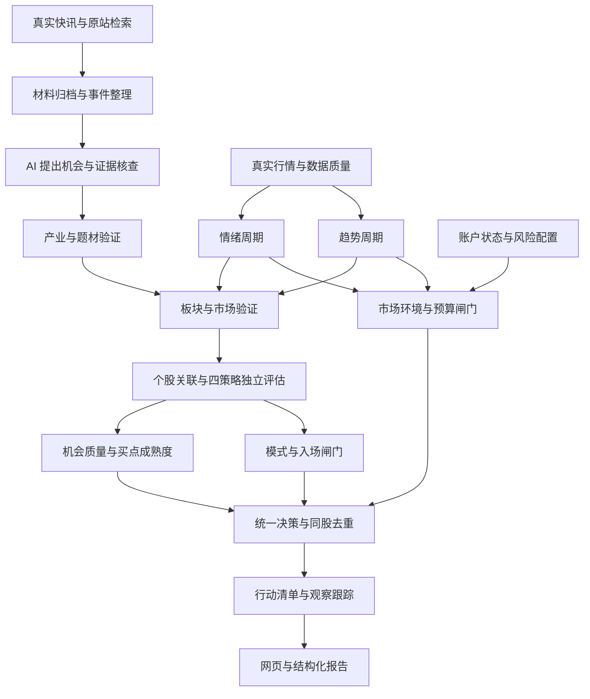

# AI 选股与交易决策助手首版设计草案

日期：2026-10-18。状态：待用户审阅，尚未冻结为实施依据。

业务来源：[新需求分析](../../../新需求分析.md)。
现状依据：[迁移分析](../../research/requirementsMigration-20261018.md)。
服务依据：[真实接口检查](../../research/serviceReadiness-20261018.md)。

## 一、目标与确认边界

用户已确认：

1. 在当前仓库继续开发独立系统，复用行情及研究基础。
2. 首版跑通情报、双周期、机会、策略评估、两道闸门和行动清单的完整最小闭环。
3. 首版接入真实新闻和在线 AI，支持主动发现机会。
4. 缺少数据或参数的能力明确标记未就绪，不能为了完整展示而制造分数或开仓结论。

本草案建议保留 Python 与 FastAPI，先使用现有网页技术交付新流程。
原始证据及行情继续文件归档，新增 SQLite 保存运行索引、业务对象和观察名单。
首版由用户在本地工作台发起分析，采集、研究和规则评估自动执行。
无人值守调度和外部主动提醒作为后续独立扩展，不混入尚未确定的频率及通知渠道。

首版可在必要交易数据未齐全时交付可用的研究流程和明确的阻断结论。
“最小闭环可运行”与“四种策略均已具备生产开仓资格”分别验收。

## 二、架构与数据流

AI 负责提出有依据的研究判断，程序负责字段校验、量化计算、规则执行和权限判定。
AI 输出不能直接修改风险配置、调用下单工具或提升权限。
两项评分作为独立解释结果，图中的连接不代表将分数相加后获得开仓许可。

## 三、首版功能要求

### R01：真实信息入口

- 接入已通过真实检查的 Fuyao 快讯列表与刷新，保留游标、来源标识、发布时间和采集时间。
- 同一材料更新保留新版本；同源转载不能简单按网址数量算独立来源。
- 归档正文、摘要或检索结果时标明材料类型，摘要不能标记为已取得原文。
- 补充检索与正文抓取使用 DeepSeek 的独立搜索、抓取 API，不能假定模型自身掌握最新资讯。
- 资讯事件库未开放外部接入的能力不作为首版依赖。

### R02：在线 AI 与主动发现

- 首选已验证可调用的 `deepseek-v4-pro`，模型编号、提示词及参数纳入版本记录。
- 从新闻和政策材料提出产业方向及催化假设，不要求用户先提供股票列表。
- 围绕待验证判断补查原始材料，记录影响路径、支持证据、反证及不确定性。
- 区分新事件、旧闻、后续更新和市场已反映预期的假设；证据不足时保留未确认状态。
- 模型结果通过结构、引文、时间、证券标识及板块映射校验后才能参与研究流程。
- 同一模型的两次提取和复核是两轮处理，不标记为两个独立研究主体。
- 保存原始返回、模型与提示词版本、材料摘要、Token 用量、失败原因及缓存引用。

### R03：双向验证与三层筛选

- 同时接收产业催化发现和市场异动发现，分别保留发现路径。
- 按产业与题材、板块与资金、个股与买点保存每层证据、结论和缺口。
- 公司业务关联需要明确材料支持，不能只因属于某个概念板块就认定受益。
- 暂未验证到公司业务时，可保留题材研究机会，但不冒充已验证的个股机会。
- 缺少必要资金口径时，明确该层未完成，成交额增加不能自动替代大单流入。

### R04：独立周期与市场环境

- 情绪周期、趋势周期分别计算，分别记录指标覆盖、时点和规则依据。
- 旧四项溢价可以成为情绪输入，不能代表完整趋势系统。
- S/A/B/C 是新环境等级，只有明确分级规则并完成配置后才输出对应等级。
- 分级规则或必要数据缺失时输出未知及原因，禁止调用旧 A～D 权限字母映射。
- 双周期冲突时保留各自结果，联合规则按配置决定策略适用性，不抹平为单个平均分。

### R05：四类机会与四策略

机会分类独立保存：新题材启动、已有主线延续、主线趋势回调、龙头二波。
策略分类独立保存：大单资金模式、主线趋势回调、龙头二波、新题材先手机会。
两组分类允许多对多关联，不逐行绑定。

每个策略都实现独立评估流程：

- 输入要求及数据口径校验。
- 筛选、入场、退出、失效和风险规则的逐项评估。
- 对应机会质量、买点成熟度及其证据贡献。
- 已匹配、等待确认、已排除或未知的评估结果。
- 数据、参数、配置启用与验证状态。

实际执行规则通过版本化策略配置提供。
首版不替用户发明大单阈值、趋势窗口、二波定义、弱转强涨停条件或止损比例。
规则未定义的检查项返回未就绪及具体原因；测试用显式参数只用于验证实现，不自动启用为生产参数。
只有空接口或统一返回未就绪，不能视为四个策略实现完成。

### R06：独立评分

- 机会质量和买点成熟度各为 0～100，保留策略、分项、权重及证据。
- 可量化部分由程序计算，研究判断由 AI 提供可核对证据和依据。
- 评分方案未配置或必要证据缺失时，输出空分数和未就绪原因。
- 首版不自动继承旧板块评分或首板观察权重，也不将多个策略得分求和。
- 分数不是涨幅、胜率或收益保证，报告不按概率展示。

### R07：两道闸门与账户输入

第一道闸门判断市场环境、极端风险和账户预算。
第二道闸门判断该证券的策略模式、必要资金、入场、退出及失效条件。
闸门各自返回允许、拒绝或未知，并保留对应规则与原因。

- 只有两道闸门均明确允许，且存在已满足条件的可用策略，才能成为符合开仓条件的机会。
- 高分或利好不能抵消硬性禁止规则。
- 首版通过本地表单或受校验的结构化导入记录账户、持仓和已实现交易，不连接券商。
- 账户状态有版本、发生时间和录入时间；缺少必要预算或持仓信息时不能声称校验通过。
- 仓位、单笔和单日风险、连续亏损暂停及集中度均需独立规则配置；不沿用旧默认比例。

### R08：行动状态与去重

按以下优先级确定股票的行动状态：

1. 已有证据明确否定逻辑、结构或个股资格：暂时排除。
2. 必要交易规则已启用、策略入场条件满足且两道闸门均允许：符合开仓条件。
3. 有部分入场信号，或仍缺必要验证、权限或预算：等待确认，显示阻断原因。
4. 逻辑成立但尚无入场信号：重点跟踪。

缺少证据与已证明逻辑不成立使用不同原因。
环境禁止开仓时仍保留有价值的研究机会，不能把所有研究对象都判为逻辑失效。
同一证券每次运行只生成一条最终行动记录，详情保留全部策略结果。
仓位按证券和关联风险暴露统一核算，不按策略条数重复分配。

### R09：运行阶段与时间

- 支持盘前、开盘后检查、10:00 修正和盘后复盘四种阶段。
- 首版用户手动启动阶段任务，任务内部自动采集、检索、调用 AI 并评估；不要求手动粘贴 AI 输出。
- 使用交易日历核验日期及时段。时段不符的请求作为研究回放处理，不能伪装当时实时运行。
- 记录 `requestedAt`、采集及分析完成时间、`asOf` 与 `generatedAt`。
- 实时流程完成采集和研究后，冻结输入集合及决策时点，再执行确定性决策。
- 所有已采用材料及分析完成时间不得晚于 `asOf`；之后到达的内容进入下一次运行。
- 历史回放使用当时留存的可用时间，不因材料发布时间早就把事后采集或分析当成当时可得。
- 盘前、盘中和盘后结果关联同一交易日，保留各阶段版本，不覆盖原有报告。

### R10：观察名单与复盘

- 观察名单持久化，包含来源运行、证券、加入时间、备注及最新状态。
- 名单跨日保留，每次运行重新评估；观察名单与实际持仓分别存储。
- 盘后记录催化进展、信号变化、已知行情表现及规则执行情况。
- 没有退出、成交和费用模型时只展示观察统计，不称为策略收益或账户回撤。
- 完整历史回测、生产权重校准和长期有效性验证分别形成后续研究任务。

### R11：输出与状态

每次结果包括市场总览、信息与催化、四类机会、个股分析和最终行动清单。
关键结论可展开查看实际数据、证据、规则版本、时间和缺失原因。

| 维度 | 状态与含义 |
| --- | --- |
| 运行 | 等待、进行中、完成、部分完成、失败 |
| 数据或服务 | 可用、未配置、不可用、过期、部分可用 |
| 策略与评分 | 就绪、规则未配置、证据不足、必要数据不可用 |
| 开仓闸门 | 允许、拒绝、未知 |
| 行动 | 重点跟踪、等待确认、符合开仓条件、暂时排除 |

没有发现机会、没有成熟买点、数据不足、配置未就绪和风险禁止分别展示。
不能为凑数量生成股票，也不能把模型失败解释为市场没有风险。

## 四、接入、持久化与界面

### 1. 服务与配置

现有 `HITHINK_FINANCE_API_KEY` 继续通过后端环境读取。
DeepSeek 使用专用 `DEEPSEEK_API_KEY`；运行服务不读取另一个开发工具的个人配置文件。
现有凭据迁入运行环境属于本机配置步骤，密钥不进入源码、日志、报告、数据库或网页响应。

初始工程限额建议：每轮最多处理 20 条新快讯、5 次搜索、5 次正文抓取、4 次模型调用，
每次模型最多生成 4,096 Token。限额属于资源控制，可配置，与交易信号阈值无关。
达到限额后保存已有结果并标记未覆盖部分；失败与重试同样消耗请求预算，禁止无限补查。
同一证据摘要、模型、提示词和参数命中已有成功研究时复用记录，明确展示原分析时间。

### 2. 保存方式

- 原始行情沿用 `SnapshotStore`，新增新闻及研究证据归档，保留摘要和来源时间。
- SQLite 保存运行元数据、机会、候选、策略结果、闸门、账户版本与观察名单。
- 决策结果按运行不可变；数据库索引只引用已成功落盘的证据，不发布半份结果。
- 中断后记录失败或部分完成，重试关联原任务；幂等键避免重复启动同一请求。
- 新库与历史输出各自保存版本，不覆盖旧冻结研究产物。

### 3. 建议接口

| 接口 | 职责 |
| --- | --- |
| `POST /api/assistant/runs` | 受校验的阶段、模式和幂等键，启动一次后台分析 |
| `GET /api/assistant/runs/{runId}` | 查询进度、模块状态和最终报告 |
| `GET /api/assistant/runs/{runId}/opportunities` | 查询该次运行的机会及证据 |
| `GET /api/assistant/runs/{runId}/stocks/{stockCode}` | 查询个股分层验证、策略、评分与闸门 |
| `GET /api/assistant/watchlist` | 读取持久化观察名单 |
| `POST /api/assistant/watchlist`、`DELETE /api/assistant/watchlist/{itemId}` | 保存和移除观察对象 |
| `POST /api/assistant/account-snapshots` | 保存经过参数、时点和版本校验的账户输入 |

新增接口延用本地访问及防伪令牌保护，不接收客户端指定的任意本机文件路径或任意代理请求。
证券代码、运行标识、导入字段、体积和来源 URL 均校验，网页不直接渲染上游 HTML。
新闻与网页中的指令只作为待分析材料，不改变系统指令、工具权限或交易规则。

### 4. 页面

- 总览：当前阶段、双周期、环境和权限，连同未知原因。
- 情报：新增催化、来源时间、证据与后续跟踪。
- 机会：四类机会、两项评分、策略来源及四种行动状态。
- 个股详情：三层验证、四策略结果、入场退出、风险预算及阻断链。
- 观察与历史：跨日名单、阶段结果及变化。
- 数据与配置：来源覆盖、服务可用性、规则版本和未就绪项。

既有行情浏览作为数据入口继续可用。优先交付工作流程，不同时引入前端框架迁移。

## 五、迁移与验收

### 1. 迁移方式

保留现有底层和旧入口，新增独立决策流程，避免一次改写旧 `PreMarketDecision` 的全部语义。
新结果使用自己的版本化契约，旧 A～D 权限只在旧报告中解释。
前端切入新流程后，再根据兼容需求决定旧入口退役，不提前删除未提交工作和历史材料。
实现按数据接入、证据研究、环境、策略、权限、界面分别组织改动，单个 PR 保持单一问题。

### 2. 首版验收矩阵

| 验收项 | 必须证明 |
| --- | --- |
| 真实接入 | 从真实快讯自动获得材料，实际调用 AI 并保存可核对的研究结果；不是固定模型输出 |
| 主动发现 | 不预先提交股票列表也能提出有证据的题材假设；没有有价值方向时允许空结果 |
| 数据诚实性 | 缺资金、分时、历史资格或公司证据时，显示对应缺口；不伪造验证通过 |
| 双周期 | 两套结果分别输出并可回放，缺少分级规则时环境未知 |
| 四策略 | 四个独立评估流程以显式测试参数覆盖成立、不成立、缺失与失效；真实配置未启用时明确未就绪 |
| 两项评分 | 独立保存分项依据；未配置返回空值；评分不能覆盖禁止规则 |
| 两道闸门 | 已拒绝或未知的任一道闸门都阻止生成符合开仓条件状态 |
| 风险去重 | 同股多策略只产生一条行动记录，不重复累计仓位预算 |
| 时点 | 迟到材料、事后 AI、旧成分及未来标签不能进入对应历史决策 |
| 运行与留痕 | 失败不伪装无机会；同一幂等请求不重复消耗；成功结果及证据可读取 |
| 使用流程 | 启动、查看原因、展开证据、加入观察、跨日更新和读取历史可以完成 |

单元测试先于核心实现，覆盖正常、边界与异常，核心覆盖率至少 80%。
新增流程完成后运行相关测试、全量测试、静态检查及必要的网页交互检查。
真实服务验证单独显式执行并限制次数，不在日常单元测试中消耗接口额度。
规则或参数尚未验证不妨碍研究闭环验收，但必须在报告中保留“不能据此获得生产开仓资格”的状态。

## 六、审阅重点

本草案需要确认的设计选择是：复用 Python/FastAPI 和现有行情底座，
新增证据驱动的独立决策流程，首版采用 Fuyao 快讯与 DeepSeek，
以手动启动、内部自动处理的方式交付完整研究和决策闭环。

交易阈值与预算保持未配置状态，逐个策略定义和验证后启用。
这不是将待定交易规则视为已经确定，而是为未就绪能力规定可实现、可验收的行为。
用户审阅本草案后，再拆分实施计划和确定执行方式。
